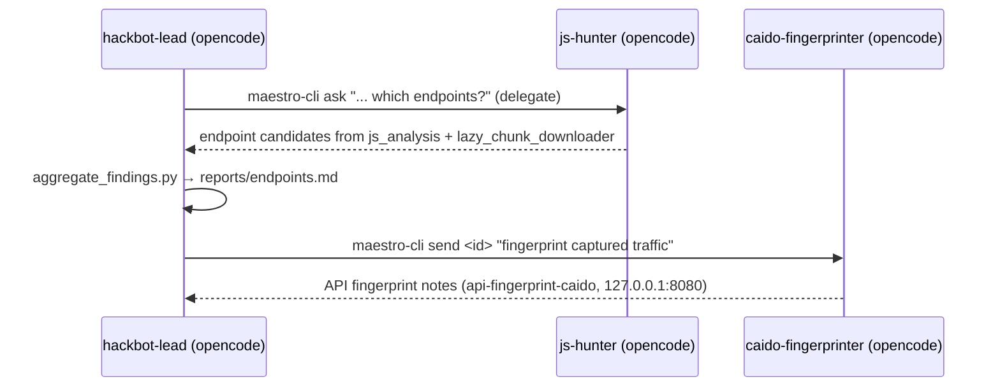

# Workflow — Maestro agents → skills / subagents

This document maps the three Maestro agents in this project to the installed
skills and subagents they use, and gives the exact `maestro-cli` command
patterns for driving them. All work described here is local and harmless; the
only traffic-adjacent step reads traffic already captured in Caido. Complete
the checklist in [[authorized-use]] before any live run. The recon data flow
itself is described in [[architecture]].

## Agent map

| Agent | Provider | Role | Installed skills / subagents used |
|-------|----------|------|-----------------------------------|
| `hackbot-lead` | opencode (`hy4-flash-free`) | Orchestrates the run; delegates and aggregates results (this agent). | calls the other agents via `maestro-cli` |
| `js-hunter` | opencode (`deepseek-v4.1-flash-free`) | Local JavaScript recon: scans bundles and collects endpoint candidates. | `js-analysis` subagent + `js_analysis` skill; `lazy_chunk_downloader` subagent + skill (optional, for code-split chunks) |
| `caido-fingerprinter` | opencode (`hy4-flash-free`) | Fingerprints APIs from traffic already captured by Caido on `127.0.0.1:8080`. | `api-fingerprint-caido` subagent + skill (runs the skill directly — no Codex CLI) |

The workflows are installed globally for OpenCode:

```
~/.config/opencode/skills/{js_analysis,lazy_chunk_downloader,api-fingerprint-caido}
~/.config/opencode/agents/{js-analysis,lazy-chunk-downloader,api-fingerprint-caido}.md
```

> [!NOTE]
> **No Codex account is used.** All three agents run through the OpenCode
> provider with free models. The `api-fingerprint-caido` subagent was rewritten
> to invoke the installed skill directly instead of shelling out to the Codex
> CLI. OpenCode's paid models require credits; the free models listed above
> work without them.

## Agent IDs

Use the agent ID (not the display name) with the CLI commands below:

| Agent | Agent ID |
|-------|----------|
| `hackbot-lead` | `fb180ca2-4e80-4d8d-a327-9fd9874ec35c` |
| `js-hunter` | `88f8e402-ebdc-4764-9da0-05a4d5216adf` |
| `caido-fingerprinter` | `948a2c1a-1194-499d-8c7a-359c8a082d97` |

Confirm the live IDs at any time with `maestro-cli list agents`.

## Invocation patterns

### Send a single prompt: `maestro-cli send <agent-id> "<prompt>"`

Headless one-turn invocation; prints a JSON response. Use for a bounded,
single-step task.

```sh
# Exact pattern
maestro-cli send <agent-id> "<prompt>"

# Example: local JS recon by js-hunter
maestro-cli send 88f8e402-ebdc-4764-9da0-05a4d5216adf \
  "Use the js_analysis skill on lab/sample-app and write all_endpoints.txt there."
```

### Pursue a goal until done: `maestro-cli goal-run <agent-id> "<goal>"`

Goal-Driven Auto Run: the agent keeps iterating toward the stated goal. Useful
when the steps are not fully known up front.

```sh
# Exact pattern
maestro-cli goal-run <agent-id> "<goal>"

# Example: fingerprint captured Caido traffic
maestro-cli goal-run 948a2c1a-1194-499d-8c7a-359c8a082d97 \
  "Fingerprint every API candidate in the captured Caido traffic on 127.0.0.1:8080." \
  --exit-criteria "A fingerprint note exists for each API candidate" \
  --max-iterations 5
```

### Delegate between agents: `maestro-cli ask`

Agent-to-agent delegation and one-off consults use `maestro-cli ask`. It is a
background consult: the answer is printed to stdout and the target agent's
open conversation is never touched.

```sh
# Exact pattern
maestro-cli ask <agent-id> "<question>" --from <your-agent-id>

# Example: hackbot-lead consults js-hunter
maestro-cli ask 88f8e402-ebdc-4764-9da0-05a4d5216adf \
  "Which endpoints did you extract from lab/sample-app?" \
  --from fb180ca2-4e80-4d8d-a327-9fd9874ec35c
```

`ask` is for a question whose answer comes back to you. To hand off a tracked
piece of work whose result the Auto Run should wait for, use
`maestro-cli dispatch <agent-id> "<self-contained task>"` instead (inside an
Auto Run it opens a hidden tab and the next turn receives the result).

## Typical orchestration



## Safety boundary

No command in this workflow points an agent at a real target. `js-hunter`
works only on local JS files, and `caido-fingerprinter` reads traffic that was
already captured for an authorized scope. Do not supply a real target in
prompts or `.env` values without written authorization and an explicit
in-scope list (see [[authorized-use]]).

## Phase 2 — feeding the harness

The local harness (`harness/`) exposes `POST /api/ingest` with a Bearer token.
After an agent writes recon results to a text file, bridge them into the harness:

```sh
cd ~/Projects/hackbots-starter
INGEST_TOKEN=<copy from harness Settings> \
  python3 harness/scripts/ingest_from_report.py lab/sample-app/all_endpoints.txt \
  --target local-lab --target-id 1 --severity low
```

Findings at or above the harness `severity_threshold` auto-fire the Discord
webhook on arrival. Open the dashboard at `http://127.0.0.1:13337`.

### Scope + run tools (MCP)

The `harness-ingest` MCP server also lets an agent read the target's **recorded
scope before starting a hunt**:

- `list_targets()` — see available target names/IDs
- `get_target_scope(target)` — full scope block (in/out scope, auth notes)
- `check_scope(target, host)` — `ALLOWED` / `DENIED` / `UNKNOWN` (deny wins)
- `start_run(target, model, budget)` / `finish_run(run_id, status)` — link a
  Maestro hunt to a harness run record

Example prompt to an agent:

```
Before any work: call get_target_scope("my-target") and confirm the host is
ALLOWED with check_scope. If it is DENIED or UNKNOWN, stop and report blocked.
Then call start_run(...), do the recon, ingest findings, and call finish_run().
```

These checks are **advisory** — they tell the agent what the dashboard records,
but they do not technically block it. The dashboard record is still the scope
ledger; enforce it in your prompts until Phase 3 wires it into the orchestrator.

## Verification

- File created: `docs/workflow.md`.
- Mentions all three agents: `hackbot-lead`, `js-hunter`, `caido-fingerprinter`.
- Contains the exact patterns `maestro-cli send <agent-id> "<prompt>"`,
  `maestro-cli goal-run <agent-id> "<goal>"`, and the `maestro-cli ask`
  delegation note.
- Updated 2026-11-23 to reflect the free OpenCode model setup and Phase 2 wiring.
